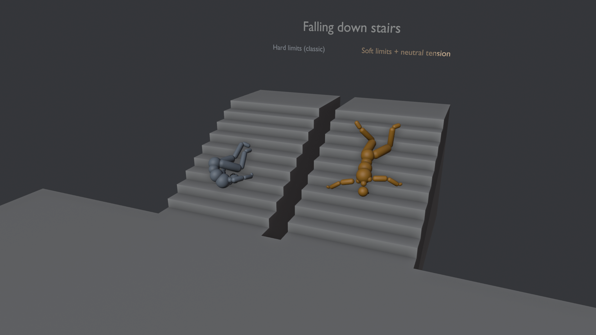

# Better Ragdoll (Blender extension)



Demo video: [promo/output/better_ragdoll_demo.mp4](promo/output/better_ragdoll_demo.mp4). Report bugs and ask questions in [Issues](https://github.com/Volko61/better-ragdoll/issues).

Ragdoll simulation for humanoid armatures, built on the ideas from *Improving ragdolls forever*:

1. **Soft limits.** Near the minimum and maximum angle of each joint, a progressive spring and extra damping slow the joint down before it reaches the hard limit. This stands in for muscles, ligaments and tendons reaching full stretch. Without it, the joint moves at full speed and stops dead at the limit.
2. **Neutral body posture tension.** A weak pull brings every joint back toward a relaxed posture loosely based on NASA's microgravity *Neutral Body Posture*: hips and knees bent, shoulders rolled forward, elbows bent, feet pointed, head tilted forward. With gravity set to 0, the character drifts into this pose.
3. **Rotational impact.** When the character is pushed, the shoulders and hips also get a rotational kick, with some randomness so the limbs don't move identically. Arms are thrown along the push, and legs swing the other way because the feet resist.
4. **Active ragdoll blend.** The character can fade from its animation into the simulation. The upper body goes limp first and the legs follow after a delay.

The extension includes its own XPBD rigid-body solver, written in pure Python. It doesn't use Bullet because Blender's rigid body constraints can't do soft limits, and their spring rest pose is always the starting pose. The result is baked to a new action on the armature.

## Install

In Blender, go to *Edit > Preferences > Get Extensions > Install from Disk…* and choose `dist/better_ragdoll-1.0.0.zip`.

To rebuild the package:

```bash
blender --command extension build --source-dir better_ragdoll --output-dir dist
```

## Use

In the 3D View sidebar, open the **Ragdoll** tab.

1. Select the armature and click **Detect Bones**. Roles are found from bone names (Mixamo, Rigify, UE, generic) and the anatomical presets are loaded. Roles, collision radius and joint limits can be edited per bone in *Properties > Bone > Ragdoll*.
2. Click **Preview Neutral Pose** to check that the joints are oriented correctly. If they aren't, set **Facing** in the *Bones* panel.
3. Choose the *Joint Model*:
   - **Soft Limits + Tension**: the improved ragdoll.
   - **Hard Limits (Classic)**: a typical game ragdoll, for comparison.
4. Set these options as needed:
   - Release frame and blend.
   - Impact.
   - Colliders: a collection, used for stairs and similar geometry, plus a ground plane.
5. Click **Simulate & Bake**. **Restore Animation** puts the original action and bone constraints back.

Tips:

- Set *Gravity* to 0 to watch the character relax into the neutral posture.
- Joint strength settings are scaled by the inertia each joint carries, so they behave the same at any character size.
- Collision shapes are capsules, sized from the skinned mesh when one exists.
